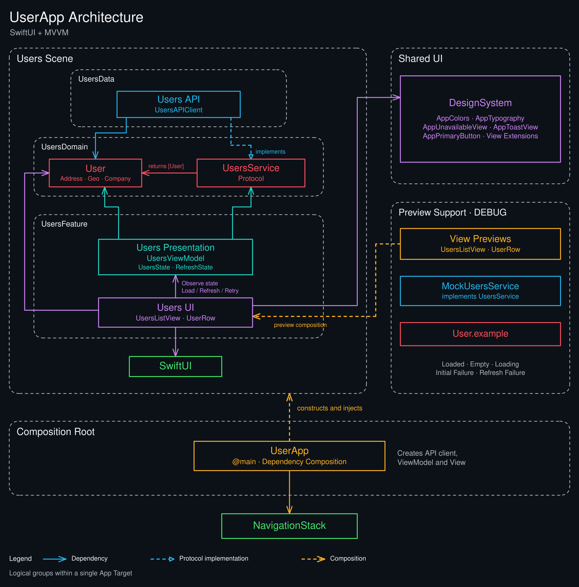
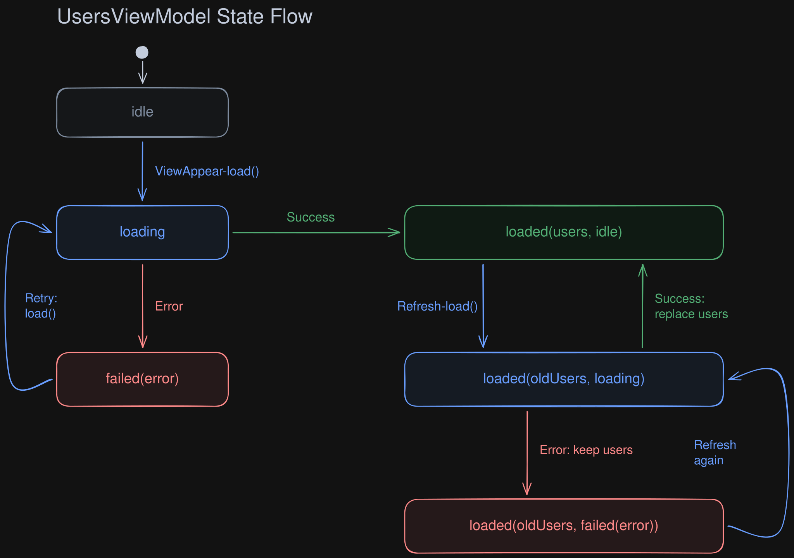
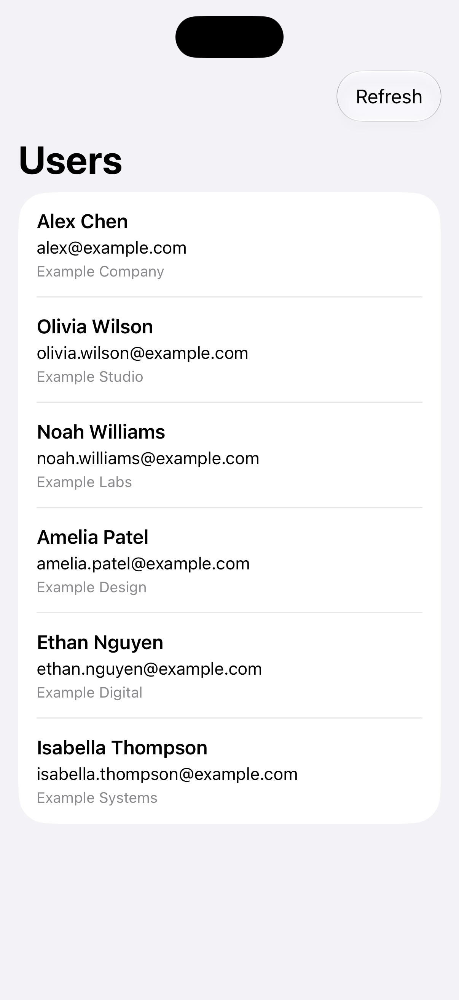
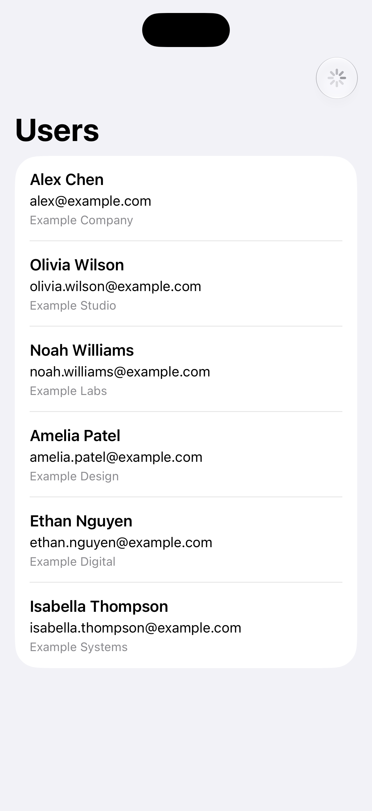
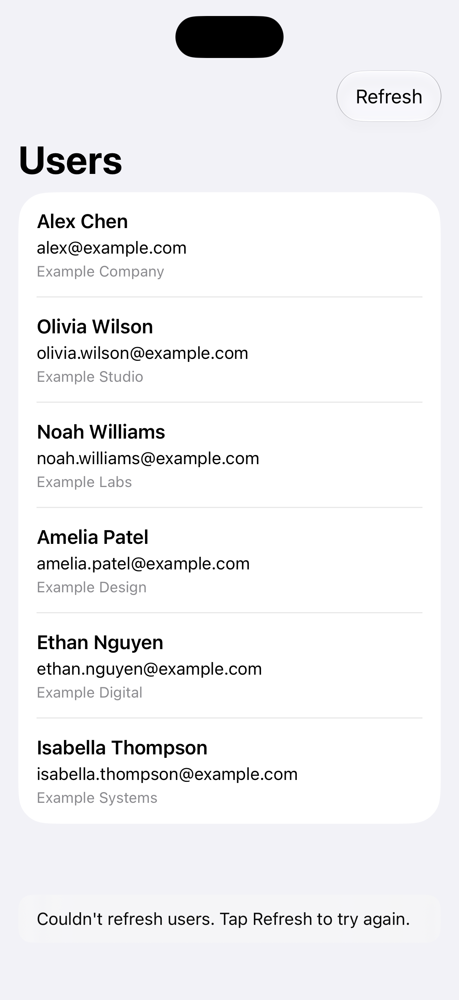
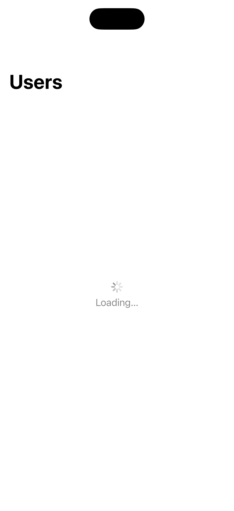
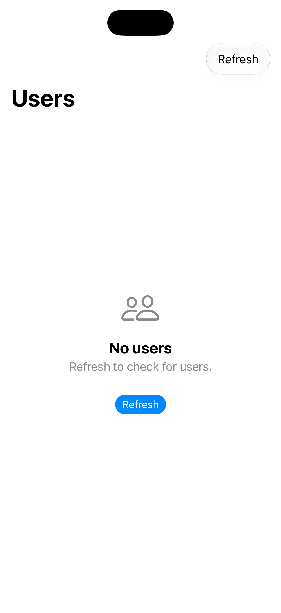
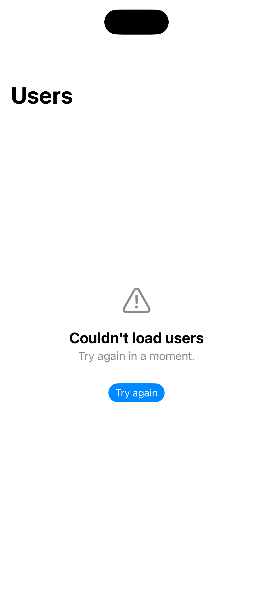

# User List App

## Bugs Fixed

- **Missing list identity:** `User` did not conform to `Identifiable`, causing `List(users)` to fail to compile. **Fix:** Added `Identifiable` conformance, using the existing `id` property as the list identity.
- **Incorrect response decoding:** The API client expected a JSON object containing a `users` array, but the endpoint returns a top-level array, causing valid responses to fail decoding. **Fix:** Decode the response directly as `[User]` with `JSONDecoder`.
- **Overlapping requests:** Repeated refreshes could start concurrent requests, allowing older responses to overwrite newer results or end the loading state prematurely. **Fix:** Guard `load()` with `isLoading` so new load requests are ignored while an initial load or refresh is in progress.
- **Incorrect ViewModel ownership:** The view created its own ViewModel using `@ObservedObject`, allowing view reconstruction to recreate the ViewModel and lose loaded data and state. **Fix:** Use `@StateObject` to retain the ViewModel across view reconstruction for the same view identity.
- **Missing HTTP validation:** The API client decoded response bodies without checking HTTP status codes, potentially treating server errors as decoding failures or successful results. **Fix:** Validate that the response is an `HTTPURLResponse` with a status code in `200..<300` before decoding; otherwise throw `UsersAPIError.invalidResponse` or `UsersAPIError.httpStatus`.
- **Cancellation treated as failure:** Cancelled requests entered the failure state, potentially displaying an error when the view's task was cancelled. **Fix:** Reject already-cancelled tasks, check cancellation after fetching, and recognize task cancellation, `CancellationError`, and `URLError.cancelled` in error handling. On cancellation, preserve loaded users and reset refresh to idle, or restore the state from before the load attempt, without displaying a new failure.

Validation approach: 
reproduce behavioral bugs with focused failing tests, apply minimal fixes, then rerun tests.

## Design Decisions & Trade-offs

- Kept MVVM lightweight by injecting `UsersAPIClient` through a small `UsersService` protocol. 
- Keep navigation ownership at the window or flow level.
- Modelled refresh separately from initial loading so existing users remain visible during refresh and after refresh failure, accepting that the displayed data may be stale.
- Ignored new load requests while one is in progress, rather than cancelling the active task.
- Kept loadRequestID and refreshErrorToastID local to the View to manage task triggering and toast presentation, including dismissal timing, while the ViewModel owns loading logic, data, and request state, including refresh errors.

## Architecture

## State Flow

## App Screenshots

Six UI states captured with mock data. Click any screenshot to view it at full resolution.

| Users loaded | Refresh in progress | Refresh failed |
| :---: | :---: | :---: |
|  |  |  |
| Six users loaded. | Users stay visible. | Users kept; retry available. |

| Initial loading (3-second delay) | Empty users | Initial load failed |
| :---: | :---: | :---: |
|  |  |  |
| Waiting for the first response. | Refresh to check again. | Retry after an error. |
